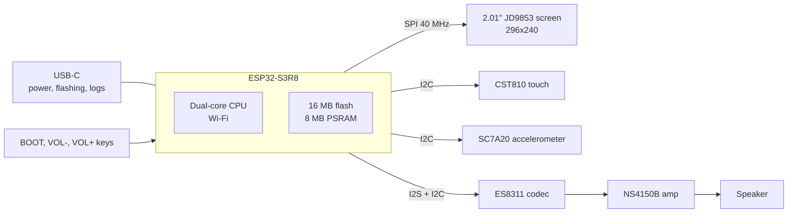
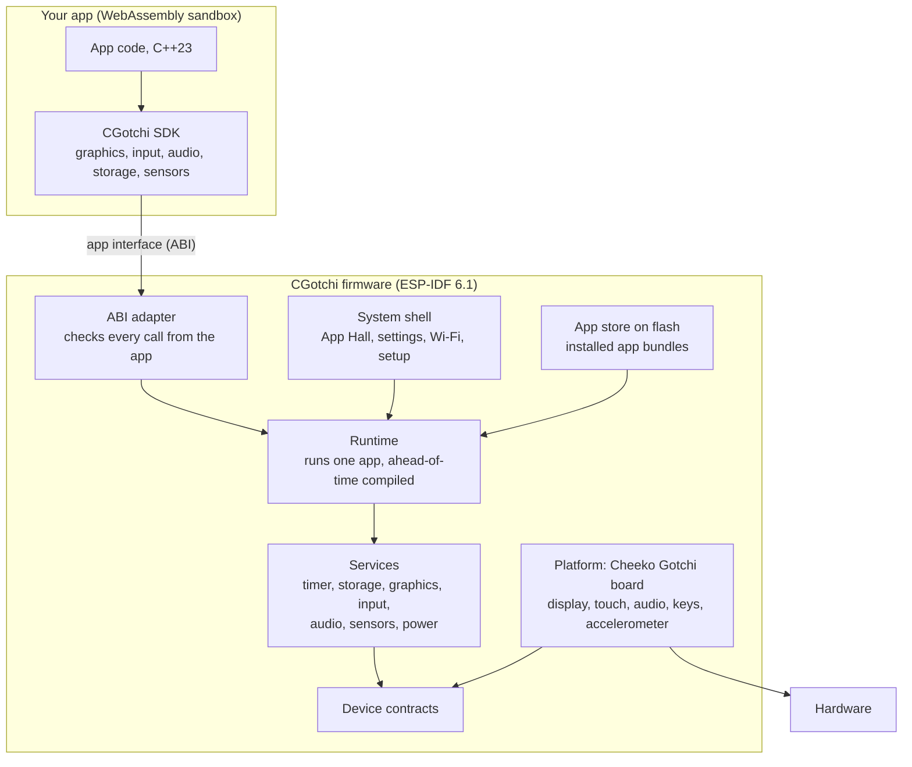
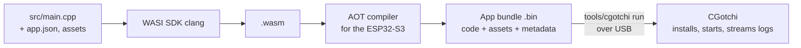
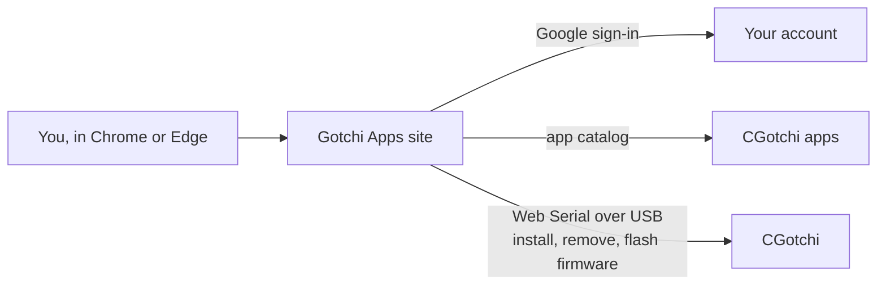
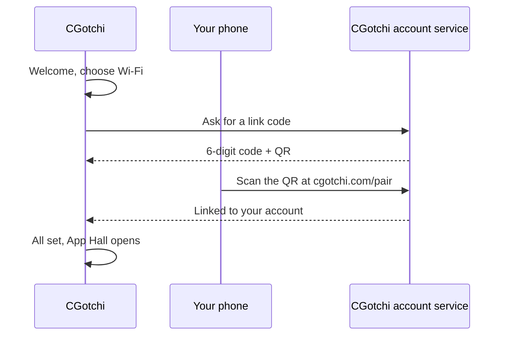

# CGotchi

**THE PROGRAMMABLE DESK PET** · *Your code finally has a body.*

CGotchi is a pocket-sized desk pet with a 2.01" full-colour screen that runs apps you write yourself.
This repository holds the CGotchi firmware, the app SDK and example apps.

- Website: <https://cgotchi.com>
- Buy on Amazon: <https://amzn.in/d/0ewWVwJt>
- Ready-made apps: the CGotchi App Store, <https://gotchi-apps.vercel.app>

Apps are written in C++23 and compiled to WebAssembly. The firmware runs each app in its own sandbox and gives it
graphics, touch, keys, audio, storage and the accelerometer, so an app never touches the hardware directly.

## How it works

### Hardware



| Part | Details |
|---|---|
| Chip | ESP32-S3R8, 16 MB flash, 8 MB octal PSRAM, native USB |
| Screen | 2.01" JD9853 IPS, shown as 296x240 landscape |
| Touch | CST810 |
| Audio | ES8311 codec + NS4150B speaker |
| Motion | SC7A20 / LIS2DH12 accelerometer |
| Keys | BOOT, VOL-, VOL+ (Confirm, Left, Right) |
| Connectivity | Wi-Fi, USB-C (power, flashing, logs, screenshots) |
| Not supported yet | Microphones, battery level, power key |

The board code lives in
[`firmware/espressif/main/platform/boards/cheeko-gotchi`](firmware/espressif/main/platform/boards/cheeko-gotchi).

### Firmware and apps

The firmware (the Host) owns the hardware and the system screens. Each app (the Guest) is a WebAssembly module
that can only reach the device through the services the Host offers.



- An app that crashes or hangs is stopped by the Host; it can't take the device down.
- Apps get graphics, touch, keys, audio output, the accelerometer, key-value storage, timers, random numbers and
  power info. Network, Bluetooth and the microphones are not open to apps yet.
- More detail: [architecture](docs/design/architecture.zh-CN.md) and [app interface](guest/abi/README.zh-CN.md)
  (both in Chinese for now).

### From code to a running app



### Installing apps and firmware from the browser

The Gotchi Apps site, <https://gotchi-apps.vercel.app>, talks to a CGotchi plugged into your computer, so you
don't need any tools installed.



### First start



## Build an app with an AI agent

Open this repository in Claude Code, Codex, Cursor or any coding agent and tell it what you want, for example:
"make a tamagotchi-style pet that gets hungry" or "a reaction game for two players". The agent asks what you want
to build, writes the app, builds it and installs it on your CGotchi over USB. The instructions it follows are in
[AGENTS.md](AGENTS.md) (Claude Code reads them through [CLAUDE.md](CLAUDE.md)).

Just want apps? Install ready-made ones from your browser at the CGotchi App Store:
<https://gotchi-apps.vercel.app>.

## Build an app by hand

App development does not need ESP-IDF. Follow the [quickstart](guest/sdk/QUICKSTART.md) to set up the toolchain,
then plug in your CGotchi with a USB-C data cable and run from the repository root:

```sh
python3 tools/cgotchi init my-app --app-id com.example.my-app --title "My App"
cd my-app
python3 ../tools/cgotchi --transport usb run
```

`run` builds, installs, starts the app and follows its logs. Ctrl-C stops the logs; the app keeps running.
See the [SDK guide](guest/sdk/README.md), the [publishing guide](guest/sdk/PUBLISHING.md) and the example apps in
[`guest/apps`](guest/apps).

## Build and flash the firmware

You need ESP-IDF 6.1 (the commit pinned in `tools/ci/firmware-sources.json`). The build path must not contain
spaces. Plug the CGotchi in directly with a USB-C data cable; on a Mac it shows up as `/dev/cu.usbmodem*`.

```sh
git submodule update --init --recursive
source /path/to/esp-idf-v6.1/export.sh
python3 -m pip install -r requirements-dev.txt
bash tools/s3.sh build-host gotchi
python3 tools/fetch_release_app_store.py
bash tools/s3.sh flash-host gotchi /dev/cu.usbmodemXXXX
bash tools/s3.sh flash-apps gotchi /dev/cu.usbmodemXXXX
```

`fetch_release_app_store.py` downloads the prebuilt stock apps, so you only need the WASI SDK and the AOT compiler
if you want to build apps yourself. More detail is in the [flashing guide](docs/development/flashing.zh-CN.md).

## Project layout

- [`firmware`](firmware/README.md): device firmware and board support.
- [`guest`](guest/README.md): app SDK, app interface and example apps.
- [`tools`](tools): command-line tool, build and flashing scripts.
- [`docs`](docs/README.md): architecture, protocols and development guides.
- [Contributing](CONTRIBUTING.md).

## License

Code, documentation and assets are licensed under [Apache-2.0](LICENSE) unless stated otherwise.
See [third-party notices](THIRD_PARTY_NOTICES.md) for dependency licenses.

CGotchi is inspired by and built on the open-source MicroPixel runtime (Apache-2.0).
